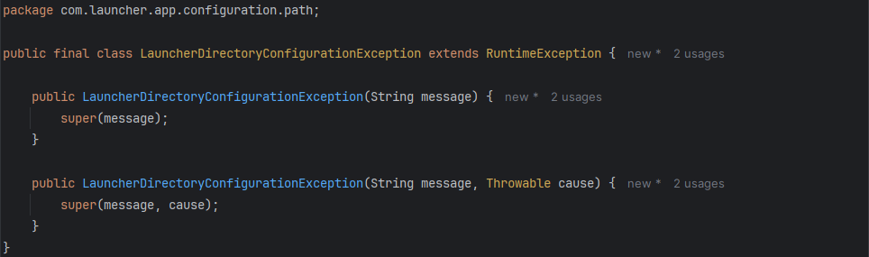

# Throwable Highlighter

[](https://github.com/Hedgerock/throwable-highlighter/actions/workflows/build.yml)
[](https://plugins.jetbrains.com/plugin/34660-throwable-highlighter)
[](https://marketplace.visualstudio.com/items?itemName=hedgerock.throwable-highlighter)

Highlights Throwable and Java classes that inherit from it.

Also available for [VS Code on Windows](https://marketplace.visualstudio.com/items?itemName=hedgerock.throwable-highlighter).

## Preview



## IntelliJ Platform Features

- Highlights Throwable types in `catch` clauses with a separate configurable color.
- Highlights Throwable types in `throws` clauses with a separate configurable color.
- Highlights declarations and references to Throwable and its subclasses.
- Highlights class names in Javadoc `@throws` and `@exception` tags with a separate configurable color.
- Supports custom exception classes and transitive inheritance.
- Lets you choose between plugin and standard IDE highlighting for each context.
- Highlights the class name in explicit imports of Throwable and its subclasses.
- Does not highlight package names or wildcard imports.
- Provides configurable highlighting through the IDE color scheme.
- Uses the standard Java class color as the default for `Throwable class`.
- Uses the `Throwable class` color as the default for `Throwable import`, `Throwable catch`, `Throwable throws`
  and `Throwable Javadoc`.

## IntelliJ Platform Configuration

Configure highlighting under:

`Settings | Editor | Color Scheme | Throwable Highlighter`

The color scheme provides five keys:

- `Throwable class` for class declarations and references;
- `Throwable import` for class names in explicit imports;
- `Throwable catch` for Throwable types in `catch` clauses;
- `Throwable throws` for Throwable types in `throws` clauses;
- `Throwable Javadoc` for class names in Javadoc `@throws` and `@exception` tags on methods and constructors.

`Throwable import`, `Throwable catch`, `Throwable throws` and `Throwable Javadoc` inherit
the `Throwable class` color until they receive explicit color settings.

Choose a source for each context under `Settings | Tools | Throwable Highlighter`.

- The source named after the context, such as `Throwable throws`, uses its color scheme attributes.
- `Java highlighting` uses the IDE's standard highlighting for that context.

The plugin source is the default for each context. Choices apply to all projects in the IDE and persist between sessions.
The color scheme stores attributes separately from the selected sources.

See the [configuration guide](docs/configuration.md) for details. The guide is
available in Russian.

## Documentation

Project documentation is available in Russian:

- [Architecture](docs/architecture.md)
- [Configuration](docs/configuration.md)
- [Roadmap](docs/roadmap.md)
- [Architecture decisions](docs/decisions/README.md)
- [Java highlighting contract](docs/specification/java-highlighting-contract.md)
- [Local checks](docs/local-checks.md)

## IntelliJ Platform Requirements

- IntelliJ IDEA
- Java support enabled

## Installation

### JetBrains Marketplace

1. Open `Settings | Plugins | Marketplace`.
2. Search for `Throwable Highlighter`.
3. Click `Install`.

You can also install it directly from the
[JetBrains Marketplace](https://plugins.jetbrains.com/plugin/34660-throwable-highlighter).

### Manual installation

1. Download the plugin ZIP from the latest GitHub release.
2. Open `Settings | Plugins`.
3. Click the gear icon and select `Install Plugin from Disk...`.
4. Select the downloaded ZIP.
5. Restart IntelliJ IDEA.

### Visual Studio Marketplace

Throwable Highlighter for VS Code highlights `Throwable` and its subclasses in Java
declarations and references, explicit imports, `catch` parameters, and `throws` clauses.

1. Install [Throwable Highlighter](https://marketplace.visualstudio.com/items?itemName=hedgerock.throwable-highlighter)
   in VS Code `1.101.0` or later on Windows.
2. Install **Language Support for Java by Red Hat** (`redhat.java`) and use Standard mode.
3. Run **Throwable Highlighter: Open Color Settings** and choose a custom color for **Throwable class**.

## Development

Building the IntelliJ Platform plugin requires JDK 25.

### Run tests

```shell
./gradlew test
```

### Run in the IntelliJ Platform sandbox

```shell
./gradlew runIde
```

### Verify plugin

```shell
./gradlew verifyPlugin
```

### Build plugin

```shell
./gradlew buildPlugin
```

The plugin distribution will be created under:

```text
build/distributions/
```

## License

Licensed under the Apache License 2.0. See [LICENSE](LICENSE) for details.
