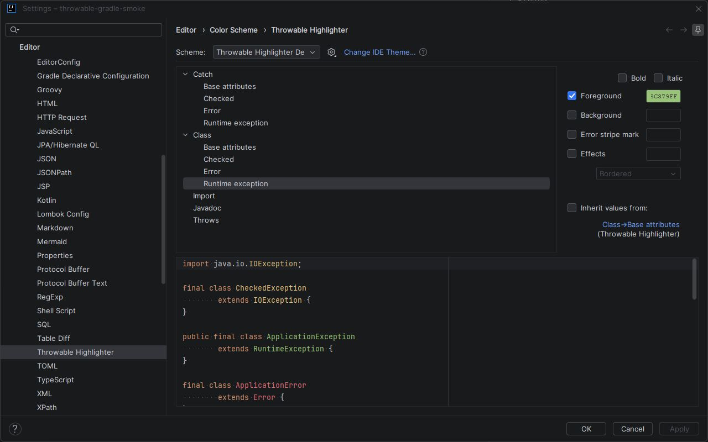
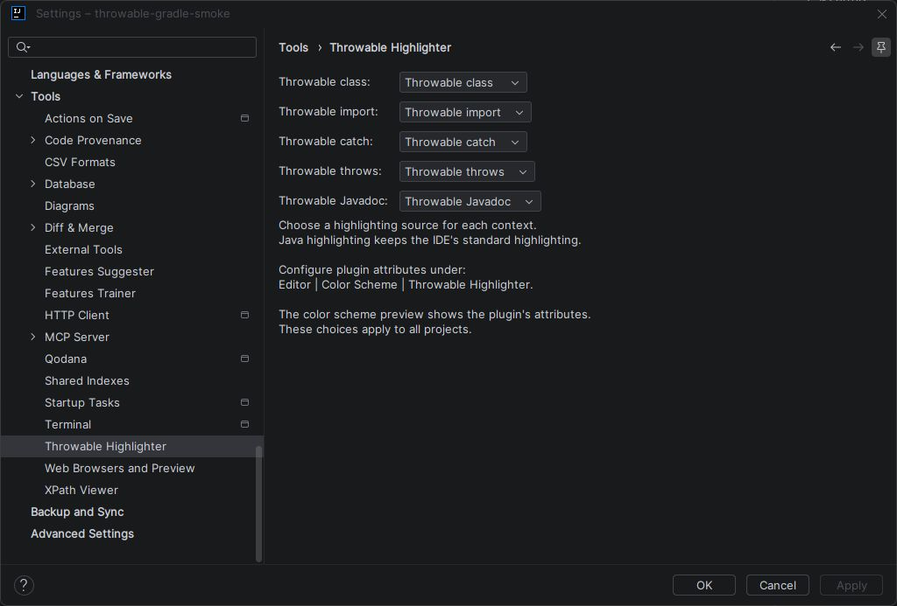

# Настройка подсветки

## Расположение настроек

Атрибуты подсветки настраиваются в разделе:

```text
Settings | Editor | Color Scheme | Throwable Highlighter
```

Раздел содержит одиннадцать настроек. Базовые атрибуты и категории контекстов
`CLASS` и `CATCH` объединены в группы:

```text
Throwable Highlighter
├─ Catch
│  ├─ Base attributes
│  ├─ Checked
│  ├─ Error
│  └─ Runtime exception
├─ Class
│  ├─ Base attributes
│  ├─ Checked
│  ├─ Error
│  └─ Runtime exception
├─ Import
├─ Javadoc
└─ Throws
```

Группировка определяет расположение настроек. Наследование атрибутов задаётся
связями цветовых ключей.

### `Class > Base attributes`

Настройка `Class > Base attributes` соответствует ключу `THROWABLE_CLASS`.

`THROWABLE_CLASS` задаёт родительские атрибуты категорий типов и остальных контекстов подсветки.

По умолчанию ключ наследует стандартный цвет Java-класса из активной цветовой схемы IDE.


### Категории CLASS

Объявления и ссылки контекста `CLASS` используют цветовой ключ категории разрешённого Java-класса.

| Настройка                   | Цветовой ключ                 | Типы                                                                 |
| --------------------------- | ----------------------------- | -------------------------------------------------------------------- |
| `Class > Checked`           | `THROWABLE_CHECKED`           | `Throwable` и его наследники вне ветвей `RuntimeException` и `Error` |
| `Class > Runtime exception` | `THROWABLE_RUNTIME_EXCEPTION` | `RuntimeException` и его наследники                                  |
| `Class > Error`             | `THROWABLE_ERROR`             | `Error` и его наследники                                             |

Все три ключа по умолчанию наследуют атрибуты `THROWABLE_CLASS`.

Собственные атрибуты категории применяются к объявлениям и ссылкам контекста `CLASS`.
При выборе `Java highlighting` для `CLASS` используется стандартное оформление IDE.



### `Import`

Настройка `Import` соответствует ключу `THROWABLE_IMPORT`.

Настройка применяется к имени класса в явном импорте.

```java
import java.io.IOException;
               ^^^^^^^^^^^
```

Имя пакета в импорте не подсвечивается.

Импорты с символом `*` не подсвечиваются.

### `Catch > Base attributes`

Настройка `Catch > Base attributes` соответствует ключу `THROWABLE_CATCH` и задаёт родительские атрибуты
категорий контекста `CATCH`.

При источнике `Throwable catch` типы в параметрах `catch` используют ключи своих категорий.

| Настройка                   | Цветовой ключ                       |
| --------------------------- | ----------------------------------- |
| `Catch > Checked`           | `THROWABLE_CATCH_CHECKED`           |
| `Catch > Runtime exception` | `THROWABLE_CATCH_RUNTIME_EXCEPTION` |
| `Catch > Error`             | `THROWABLE_CATCH_ERROR`             |

Категории определяются по тем же правилам, что и для `CLASS`.
В multi-catch каждый тип классифицируется и подсвечивается отдельно.

Все три ключа по умолчанию наследуют атрибуты `THROWABLE_CATCH`.
Ранее сохранённые атрибуты `THROWABLE_CATCH` применяются к категориям,
пока для них сохраняется наследование.

При выборе `Java highlighting` для `CATCH` все категории параметров `catch`
получают стандартное оформление IDE.

```java
catch (IOException exception) {
        ^^^^^^^^^^^
}
```


### `Throws`

Настройка `Throws` соответствует ключу `THROWABLE_THROWS`.

Настройка применяется к `Throwable` и его наследникам в списке `throws` метода или конструктора.

```java
import java.io.IOException;

void execute() throws IOException {
                      ^^^^^^^^^^^
}
```

### `Javadoc`

Настройка `Javadoc` соответствует ключу `THROWABLE_JAVADOC`.

Настройка применяется к имени класса `Throwable` или его наследника в блочных
Javadoc-тегах `@throws` и `@exception` методов и конструкторов.

```java
/**
 * @throws java.io.IOException if execution fails
 */
void execute() throws java.io.IOException {
}
```

В квалифицированной ссылке подсвечивается только имя класса.
Имя пакета, квалификаторы, имя тега и описание исключения сохраняют
стандартное оформление Javadoc.

Оба тега используют одну настройку. Другие Javadoc-теги и inline-ссылки
сохраняют стандартную подсветку IDE.

Неразрешённые ссылки и типы, не относящиеся к Throwable, не подсвечиваются.

---

## Источники подсветки

Источник каждого контекста выбирается отдельно в `Settings | Tools | Throwable Highlighter`.

- Вариант с именем контекста, например `Throwable throws`, использует атрибуты плагина.
  Для `CLASS` и `CATCH` применяется ключ категории типа.
- `Java highlighting` использует стандартное оформление IDE для элементов этого контекста.

По умолчанию все контексты используют источник плагина. При обновлении с версии 1.4.0
загружается ранее сохранённый выбор для `CATCH`.

Выбор применяется ко всем проектам IDE и сохраняется между запусками.
`Apply` и `OK` применяют настройки к открытым редакторам. `Cancel` отменяет неприменённые изменения.

Атрибуты хранятся в цветовой схеме отдельно от источников.
Предпросмотр цветовой схемы показывает атрибуты плагина для всех контекстов.

Подписи источников сохраняются: `Throwable class`, `Throwable import`,
`Throwable catch`, `Throwable throws` и `Throwable Javadoc`.

В цветовой схеме этим контекстам соответствуют группы `Class` и `Catch`,
а также настройки `Import`, `Throws` и `Javadoc`.



Например, для `Throwable class` можно выбрать `Java highlighting`, а для `Throwable throws`
оставить источник плагина. Тогда обычные ссылки на классы получают стандартное оформление IDE,
а типы в `throws` используют атрибуты `THROWABLE_THROWS`. Если для этого ключа включено наследование,
цвет берётся из `THROWABLE_CLASS`.

---

## Наследование цвета

Ключи категорий `CLASS` и базовые ключи контекстов `IMPORT`, `CATCH`, `THROWS` и `JAVADOC`
по умолчанию наследуют атрибуты `THROWABLE_CLASS`.

Ключи категорий `CATCH` по умолчанию наследуют атрибуты `THROWABLE_CATCH`.
Сам `THROWABLE_CATCH` наследует атрибуты `THROWABLE_CLASS`.

Собственные атрибуты категорий `CLASS` применяются к объявлениям и обычным ссылкам.
Собственные атрибуты категорий `CATCH` применяются к типам в параметрах `catch`.

Изменение родительских атрибутов применяется к наследующим ключам,
пока для них сохраняется наследование.


---

## Ограничения

Настройки применяются только к Java-коду.

Подсветка доступна для типов, которые могут быть разрешены IntelliJ IDEA и являются `Throwable` либо его наследниками.
