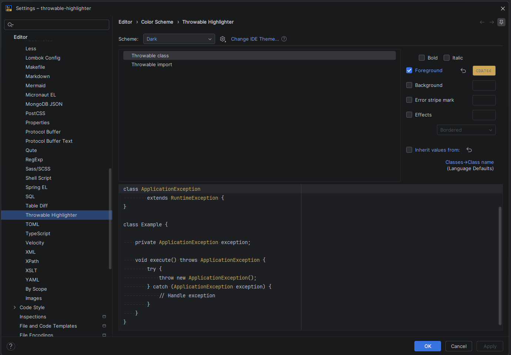
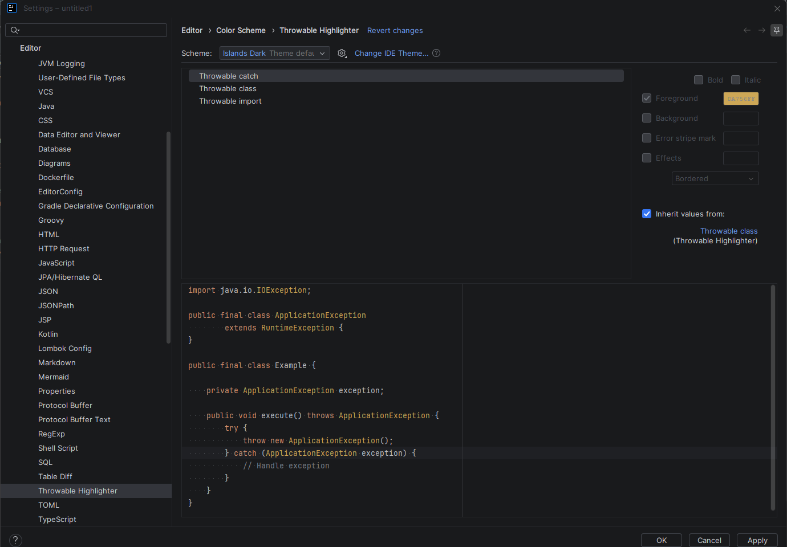
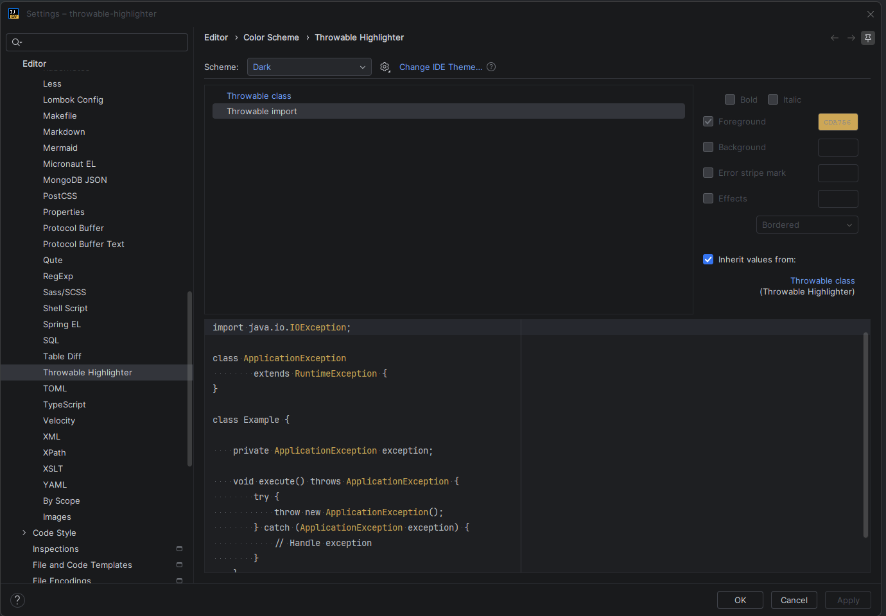

# Настройка подсветки

## Расположение настроек

Атрибуты подсветки настраиваются в разделе:

```text
Settings | Editor | Color Scheme | Throwable Highlighter
```

Раздел содержит пять цветовых ключей:

- `Throwable class`;
- `Throwable import`;
- `Throwable catch`;
- `Throwable throws`;
- `Throwable Javadoc`.

### `Throwable class`

Ключ `Throwable class` соответствует `THROWABLE_CLASS`.

`THROWABLE_CLASS` применяется к объявлениям и ссылкам на `Throwable` и его наследников.

По умолчанию ключ наследует стандартный цвет Java-класса из активной цветовой схемы IDE.



### `Throwable import`

Ключ `Throwable import` соответствует `THROWABLE_IMPORT`.

Он применяется к имени класса в явном импорте.

```java
import java.io.IOException;
               ^^^^^^^^^^^
```

Имя пакета в импорте не подсвечивается.

Импорты с символом `*` не подсвечиваются.

### `Throwable catch`

Ключ `Throwable catch` соответствует `THROWABLE_CATCH`.

При источнике `Throwable catch` ключ применяется к `Throwable` и его наследникам в параметре `catch`.

```java
catch (IOException exception) {
        ^^^^^^^^^^^
}
```



### `Throwable throws`

Ключ `Throwable throws` соответствует `THROWABLE_THROWS`.

Он применяется к `Throwable` и его наследникам в списке `throws` метода или конструктора.

```java
import java.io.IOException;

void execute() throws IOException {
                      ^^^^^^^^^^^
}
```

### `Throwable Javadoc`

Ключ `Throwable Javadoc` соответствует `THROWABLE_JAVADOC`.

Он применяется к имени класса `Throwable` или его наследника в блочных
Javadoc-тегах `@throws` и `@exception` методов и конструкторов.

```java
/**
 * @throws java.io.IOException if execution fails
 */
void execute() throws java.io.IOException {
}
```

В квалифицированной ссылке подсвечивается только имя класса.
Имя пакета, квалификаторы, имя тега и описание исключения сохраняют
стандартное оформление Javadoc.

Оба тега используют одну настройку. Другие Javadoc-теги и inline-ссылки
сохраняют стандартную подсветку IDE.

Неразрешённые ссылки и типы, не относящиеся к Throwable, не подсвечиваются.

---

## Источники подсветки

Источник каждого контекста выбирается отдельно в `Settings | Tools | Throwable Highlighter`.

- Вариант с именем контекста, например `Throwable throws`, применяет атрибуты соответствующего ключа цветовой схемы.
- `Java highlighting` использует стандартное оформление IDE для элементов этого контекста.

По умолчанию все контексты используют источник плагина. При обновлении с версии 1.4.0
загружается ранее сохранённый выбор для `CATCH`.

Выбор применяется ко всем проектам IDE и сохраняется между запусками.
`Apply` и `OK` применяют настройки к открытым редакторам. `Cancel` отменяет неприменённые изменения.

Атрибуты хранятся в цветовой схеме отдельно от источников.
Предпросмотр цветовой схемы показывает атрибуты плагина для всех контекстов.

Например, для `Throwable class` можно выбрать `Java highlighting`, а для `Throwable throws`
оставить источник плагина. Тогда обычные ссылки на классы получают стандартное оформление IDE,
а типы в `throws` используют атрибуты `THROWABLE_THROWS`. Если для этого ключа включено наследование,
цвет берётся из `THROWABLE_CLASS`.

---

## Наследование цвета

По умолчанию `Throwable import`, `Throwable catch`, `Throwable throws`
и `Throwable Javadoc` наследуют цвет от `Throwable class`.

Изменение цвета `Throwable class` применяется к наследуемым атрибутам этих ключей, пока для соответствующего
ключа не задано отдельное значение.

Отдельная настройка ключа влияет только на соответствующий контекст.

Чтобы вернуть наследование, необходимо сбросить явно заданные атрибуты
соответствующего ключа в настройках цветовой схемы.



---

## Ограничения

Настройки применяются только к Java-коду.

Подсветка доступна для типов, которые могут быть разрешены IntelliJ IDEA и являются `Throwable` либо его наследниками.
