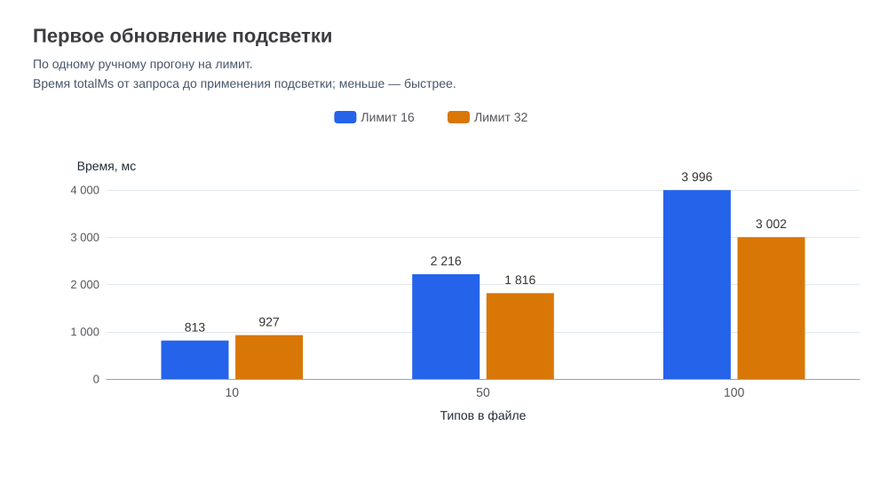
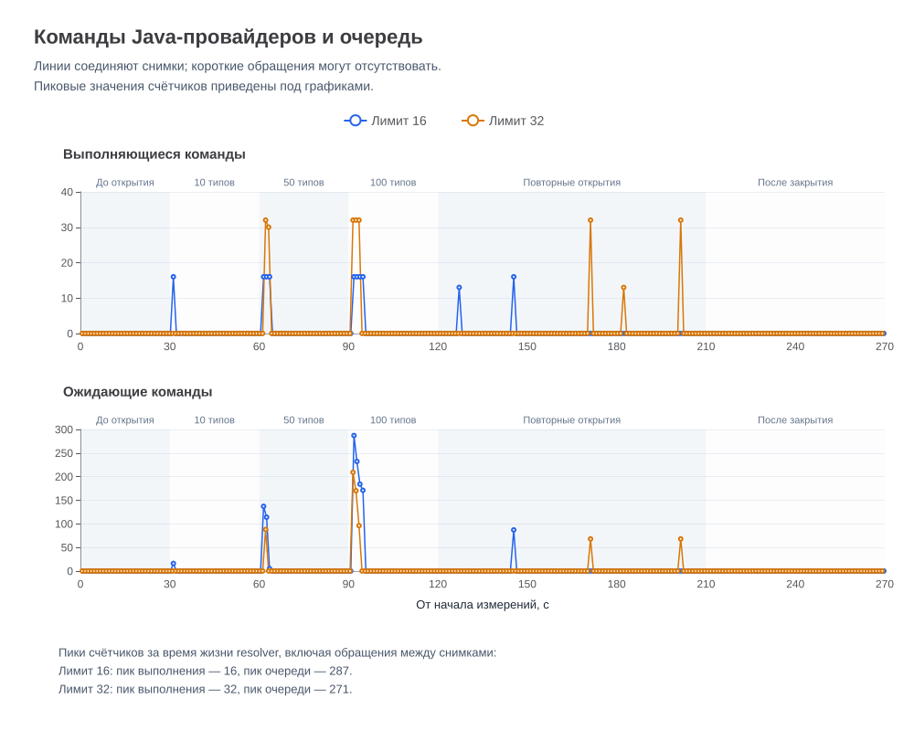
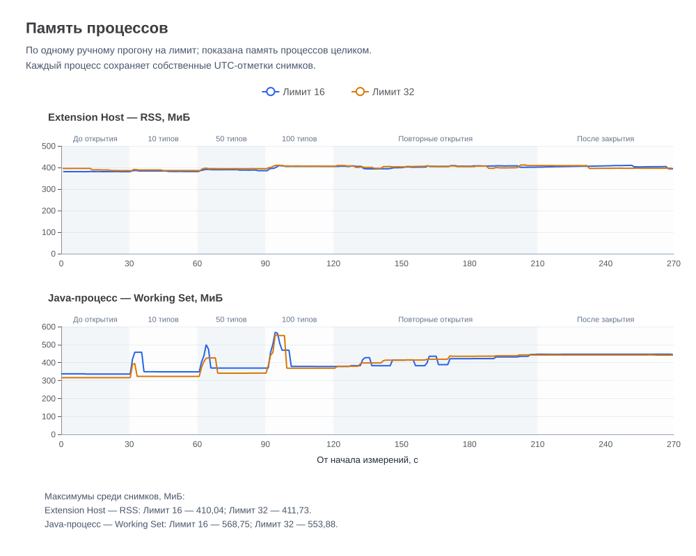
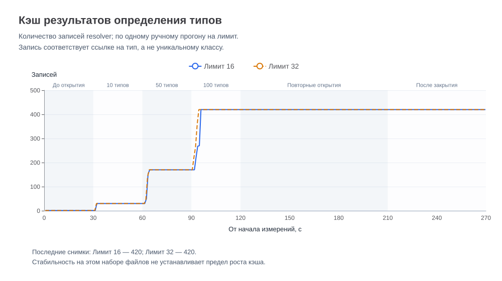
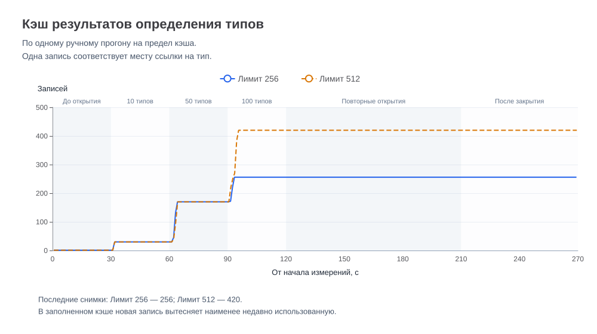

# Производительность прототипа VS Code

## Назначение

Документ описывает методику и результаты измерений планирования обновлений, обращений к Java-поддержке и потребления ресурсов.

Результаты используются для выбора оптимизации и последующего сравнения.

## Состояние

Выполнены контролируемые измерения одного обновления, серии обновлений, двух видимых редакторов и освобождения контроллера
при незавершённом определении типов.

Выполнены первые измерения определения типов и задержки обновления подсветки с настоящей Java-поддержкой.

Сравнены интервалы debounce 120 и 150 мс при максимальном ожидании 500 мс. По результатам сравнения выбран интервал 120 мс.
Изменение реализовано в коммите `8cd141e`.

Режим локальных измерений ресурсов реализован в коммите `24218c6`.

Выполнен первый ручной прогон с одним Java-файлом. Зафиксированы показатели памяти Extension Host и состояние resolver.

Выполнен нагрузочный прогон со 100 пользовательскими типами исключений и повторными открытиями файлов. Показатели Extension
Host и Java-сервера сопоставлены по UTC.

Общий ограничитель обращений к Java-провайдерам реализован согласно
[ADR-0027](../decisions/0027-vscode-java-provider-concurrency.md).

Выполнено сравнение лимитов 16 и 32. Для текущей реализации выбран лимит 32.

Сравнены пределы кэша 256 и 512 записей. Для выпуска выбран предел 512 согласно [результатам сравнения](#сравнение-лимитов-кэша-результатов).

Для контроллера подсветки выбран предел 64 незавершённых определений по итогам
[сравнения пределов](#сравнение-пределов-незавершённых-определений).

Для предрелизной проверки выбран [контрольный профиль](#контрольные-бюджеты-производительности).

## Окружение

Для каждого прогона фиксируются:

- коммит исходного кода;
- ОС, процессор и объём оперативной памяти;
- версии VS Code и Java-расширения;
- версии используемых runtime;
- состав включённых расширений;
- параметры исходных данных;
- состояние Java-поддержки и кэшей;
- способ запуска и измерения.

Измерения до и после изменения выполняются в сопоставимом окружении.

## Контролируемые измерения контроллера

Стенд использует настоящий ThrowableDecorationController и управляемые зависимости поиска кандидатов и определения типов.

Набор кандидатов и задержка resolver задаются явно. Ответы не зависят от индексации проекта.

Эти измерения оценивают планирование работы контроллера. Они не подтверждают производительность настоящей Java-поддержки.

Начальные параметры сценариев:

- 100 и 1000 кандидатов в каждом редакторе;
- задержка resolver 250 мс;
- пять повторений каждого сочетания параметров.

Параметры нагрузки не являются бюджетами производительности.

| Сценарии              | Действие                                      |
|-----------------------|-----------------------------------------------|
| Одно обновление       | Один вызов refresh после подготовки редактора |
| Серия обновлений      | 20 вызовов refresh с интервалом 100 мс        |
| Несколько редакторов  | Обновление двух видимых редакторов            |
| Освобождение ресурсов | Dispose при незавершённом определении типов   |

Для каждого сценария фиксируются:

- количество запросов обновления;
- количество вызовов resolver;
- максимальное количество одновременно незавершённых вызовов;
- количество применённых результатов;
- длительность актуального обновления;
- общее время завершения запущенной работы.

В обычных сценариях завершение определяется по применению актуального результата во всех видимых редакторах. Возврат из
refresh не считается завершением асинхронной работы.

В сценарии dispose ожидается завершение начатых обращений к управляемому resolver. Контрольный переход к следующему обороту
цикла событий позволяет проверить отсутствие позднего применения результата.

Устаревшие результаты и результаты после dispose не применяются.

## Измерения с настоящей Java-поддержкой

Измерения выполняются отдельно в Extension Host с фиксированными версиями VS Code и Java-расширения.

Проверяются:

- первоначальная готовность Java и появление подсветки;
- повторное открытие файлов после прогрева;
- продолжительное редактирование;
- переключение редакторов;
- несколько видимых Java-файлов;
- повторные циклы открытия и закрытия файлов.

Для межфайловой ссылки на NestedException выполнено десять пар измерений в Extension Host после готовности Java-сервера.
В каждой паре выполняются разрешение типа после очистки кэша расширения и повторное обращение к той же ссылке.
Медиана составляет 26,866 мс после очистки кэша и 0,020 мс при повторном обращении.

Исходные данные и последовательность действий фиксируются перед прогоном. Подготовка и загрузка компонентов окружения
учитываются отдельно.

Время ожидания Java-поддержки отделяется от вычислений расширения.

### Задержка от правки до применения подсветки

Режим локальных замеров реализован в коммите `fb63435` согласно ADR-0025.

Для запуска расширение собирается командой `npm run compile` из каталога `prototypes/vscode`. В конфигурации Extension
Development Host задаётся `THROWABLE_HIGHLIGHTER_MEASURE_REFRESH=1`. Записи `[refresh-measurement]` выводятся в канал
`Throwable Highlighter Prototype`.

Исходный ручной прогон выполнен после готовности Java-сервера с задержкой debounce 150 мс и максимальным ожиданием 500 мс.
В выборки включены записи с `reason: "document-change"` и `mode: "deferred"`.

| Сценарий          | Применённых обновлений в выборке | Медиана ожидания запуска, мс | Медиана обработки, мс | Медиана полной задержки, мс | Диапазон полной задержки, мс |
|-------------------|---------------------------------:|-----------------------------:|----------------------:|----------------------------:|-----------------------------:|
| Одиночные правки  |                               10 |                       157,04 |                 24,05 |                      186,37 |                173,26–239,96 |
| Удержание клавиши |                                6 |                       154,66 |                 20,89 |                      175,80 |                141,11–184,17 |

Для правок `waitMs` отсчитывается от получения события изменения текста до запуска
обработки редакторов и включает очистку кэша. `processingMs` измеряется от запуска
обработки до возврата из последнего `setDecorations()` для редактора.
`totalMs` охватывает оба этапа.

### Сравнение интервалов debounce

Выполнены две ручные серии одиночных правок с интервалами debounce 120 и 150 мс.
Максимальное ожидание в обеих сериях составляет 500 мс.

Статистика включает все применённые обновления каждой серии.

| Debounce, мс | Применённых обновлений | Медиана ожидания запуска, мс | Медиана обработки, мс | Медиана полной задержки, мс | Диапазон полной задержки, мс |
|-------------:|----------------------:|----------------------------:|---------------------:|---------------------------:|----------------------------:|
|          120 |                    16 |                      124,98 |                25,18 |                     150,12 |               141,73–176,27 |
|          150 |                    18 |                      158,45 |                26,16 |                     185,01 |               170,40–488,22 |

В выполненных сериях медиана полной задержки при debounce 120 мс ниже на 34,89 мс,
или приблизительно на 18,9%. Основное уменьшение приходится на ожидание запуска.

Наибольшая полная задержка в серии 150 мс включает 328,72 мс обработки.
Уменьшение debounce само по себе не устраняет задержки этого этапа.

В коммите `8cd141e` закреплены debounce 120 мс и максимальное ожидание 500 мс.
Тест контроллера проверяет отсутствие нового запуска на 119-й миллисекунде
и его выполнение при достижении 120 мс.

Окружение ручных серий — VS Code `1.145.0`, `redhat.java` `1.58.0`.
Java-файл — `docs\specification\fixtures\java\transitive\src\throwablehighlighter\fixture\exception\BaseException.java`.

## Память

Память Extension Host и Java-сервера учитывается отдельно.

Для Extension Host фиксируются исходное потребление, пиковое потребление и состояние после завершения нагрузки.

Повторные циклы после прогрева проверяются на продолжающийся рост удерживаемых данных. Единичный рост RSS не считается
самостоятельным подтверждением утечки.

Для собственных кэшей и незавершённых операций фиксируются размер, условия очистки и поведение при повторных циклах.

Общая память Extension Host не приписывается целиком Throwable Highlighter.

### Локальные измерения ресурсов

Режим реализован согласно [ADR-0026](../decisions/0026-vscode-resource-measurement.md).

При запуске Extension Development Host задаётся `THROWABLE_HIGHLIGHTER_MEASURE_RESOURCES=1`.

Первый снимок формируется при запуске сборщика. Последующие снимки формируются с заданным периодом 1000 мс. Фактический
интервал зависит от выполнения цикла событий Extension Host.

Записи `[resource-measurement]` выводятся в канал `Throwable Highlighter Prototype`.

Снимок содержит идентификатор процесса, время от начала сбора `elapsedMs`, время формирования `capturedAtUtc`,
показатели памяти, поколение кэша, количество сохранённых и ожидающих результатов,
текущее и пиковое количество вызовов Java-провайдеров.

`elapsedMs` вычисляется по монотонным часам. `capturedAtUtc` используется для сопоставления независимых журналов.

Очистка кэша не обнуляет счётчики незавершённых обращений и достигнутые пики.

### Первый ручной прогон

Прогон выполнен в рабочей копии на основе `21e3fbc`.
Реализация режима зафиксирована в коммите `24218c6`.

Использован файл
`docs/specification/fixtures/java/transitive/src/throwablehighlighter/fixture/exception/BaseException.java`.

Сценарий включает ожидание готовности Java, редактирование комментария и последующее ожидание без изменений текста.

Получены 94 снимка за 94,45 секунды. Период правок оценён по изменениям cacheGeneration и составляет примерно 40–61 секунду.

| Момент                             | Время от начала сбора, с | RSS, МиБ | heapUsed, МиБ |
|------------------------------------|-------------------------:|---------:|--------------:|
| Перед периодом правок              |                    38,96 |   383,76 |        167,78 |
| Первый снимок последнего поколения |                    61,10 |   381,50 |        170,63 |
| Конец наблюдения                   |                    94,45 |   377,26 |        169,67 |

Значения памяти описывают процесс Extension Host с загруженными расширениями.

Максимальный зарегистрированный RSS составляет 461,71 МиБ на 25,83 секунде, до периода правок.

Пик незавершённых вызовов Definition Provider составляет шесть обращений. Вызовы Document Symbol Provider в этом сценарии
отсутствуют.

В последних 34 снимках поколение кэша равно 50, сохранена одна запись. Карта ожидающих результатов пуста, активные обращения
отсутствуют.

Прогон подтверждает работу режима измерений и завершение обращений после нагрузки. Оценка устойчивого потребления памяти
требует повторных циклов и более крупного набора файлов.

Память Java-сервера в первом ручном прогоне не измерялась.

[Снимки первого прогона](data/vscode-resources-initial.json).

### Нагрузочный прогон со 100 типами

Прогон выполнен в рабочей копии на основе `df598ff`. Состояние рабочей копии на момент запуска сохранено в архиве измерений.

Генератор `tooling/performance/create-resource-workspace.mjs` создаёт отдельную рабочую область: 100 классов исключений с
прямым наследованием от `RuntimeException` и три файла использования. Файлы `Usage010`, `Usage050` и `Usage100` содержат
явные импорты и поля для 10, 50 и 100 типов соответственно.

Java-поддержка работает в режиме `Standard`. Перед нагрузкой открывается `ProbeException0001`, ожидается готовность Java
и завершение обращений, затем Java-редакторы закрываются.

Одновременно открыт не более чем один Java-редактор. Текст и настройки не изменяются.

| Интервал, с | Действие                                            |
|-------------|-----------------------------------------------------|
| 0–30        | Ожидание с закрытыми Java-редакторами               |
| 30–60       | Открытие `Usage010`                                 |
| 60–90       | Открытие `Usage050` вместо предыдущего файла        |
| 90–120      | Открытие `Usage100` вместо предыдущего файла        |
| 120–150     | Повторное открытие трёх файлов, по 10 секунд каждый |
| 150–180     | Второй повторный цикл                               |
| 180–210     | Третий повторный цикл                               |
| 210–270     | Ожидание с закрытыми Java-редакторами               |

Java-процесс измеряется отдельным сборщиком `tooling/performance/measure-java-process.ps1`. Сборщик определяет стандартный
Java-сервер по PID Extension Host и сохраняет Working Set и Private Bytes.

В окне анализа получены 268 снимков Extension Host и 267 снимков Java-процесса. Журналы сопоставлены по `capturedAtUtc`.
Сбор выполняется независимо, снимки процессов не являются одновременными.

Названия этапов описывают план ручных действий. Они не являются автоматической регистрацией открытия редактора.

В таблице приведены последние снимки соответствующих этапов. Значения памяти указаны в МиБ.

| Этап                           | Записей кэша | Extension Host RSS | heapUsed | Java Working Set |
|--------------------------------|-------------:|-------------------:|---------:|-----------------:|
| Исходное состояние             |            1 |             386,45 |   177,59 |           329,28 |
| После `Usage010`               |           30 |             387,27 |   179,16 |           333,70 |
| После `Usage050`               |          170 |             398,04 |   183,33 |           361,77 |
| После `Usage100`               |          419 |             408,37 |   176,45 |           370,00 |
| После трёх повторных циклов    |          420 |             411,38 |   168,87 |           469,46 |
| После заключительного ожидания |          420 |             398,07 |   169,62 |           468,68 |

Поколение кэша в окне анализа равно 1. В первом повторном цикле размер кэша достигает 420 записей и сохраняется до конца
наблюдения. Ключ привязан к месту ссылки, поэтому количество записей отличается от количества классов.

При первых открытиях файлов с 10, 50 и 100 типами пики вызовов Definition Provider составляют 33, 153 и 303.
Пик Document Symbol Provider составляет 45 вызовов и достигается в первом повторном цикле.
Пики двух провайдеров относятся к разным моментам.

В течение заключительной минуты карта ожидающих результатов пуста, активные вызовы обоих провайдеров в полученных снимках
отсутствуют. Короткие обращения между снимками могут оставаться незарегистрированными.

Максимальный зарегистрированный RSS Extension Host составляет 414,85 МиБ, heapUsed — 187,24 МиБ. Для Java-процесса максимальный
Working Set составляет 590,34 МиБ, Private Bytes — 641,06 МиБ.

В заключительную минуту Working Set Java находится в диапазоне 468,68–469,63 МиБ, Private Bytes — 520,46–521,46 МиБ.

Прогон подтверждает стабилизацию размера кэша для выбранного набора файлов и завершение незавершённых обращений. Отсутствие
утечек для других нагрузок этим прогоном не подтверждается.

Измерения исходного нагрузочного прогона выполнены без общего ограничителя обращений к Java-провайдерам.
Поведение с ограничителем рассматривается в отдельном сравнении.

[Архив нагрузочного прогона](data/vscode-resources-scale.json).

## Сравнение лимитов Java-провайдеров

Общий ограничитель реализован в коммите `7d419a7` согласно
[ADR-0027](../decisions/0027-vscode-java-provider-concurrency.md).

Ограничитель совместно используется командами Definition Provider и Document Symbol Provider.
Лимит относится к начатым и незавершённым командам resolver.
Количество внутренних задач Java-сервера этим ограничением не определяется.

### Условия сравнения

Для лимитов 16 и 32 выполнено по одному ручному прогону.

Использован прежний набор из 100 классов исключений и файлов использования на 10, 50 и 100 типов.
Продолжительность каждого прогона составляет 270 секунд. Первые открытия сменяются тремя повторными циклами
и заключительной минутой с закрытыми Java-редакторами.

Одновременно открыт не более чем один Java-редактор. Текст и настройки во время измерения не изменяются.
Диагностическая команда Inspect Definition не вызывается.

Окружение: Windows 11 Pro `10.0.26200`, Intel Core i7-11700KF, около 32 ГиБ оперативной памяти,
VS Code `1.145.0`, `redhat.java` `1.58.0`, Java `25.0.4.1`.
Параметры Java heap: `-Xmx2G` и `-Xms100m`.

Оба прогона выполнены в рабочих копиях на основе `7d419a7`.
В прогоне с лимитом 32 значение внутреннего параметра изменено локально.
Состояние рабочей копии сохранено в каждом архиве.

В каждом окне анализа получены 267 снимков Extension Host, 267 снимков Java-процесса
и 12 записей о применённых обновлениях подсветки.

Исходные данные:

- [Лимит 16](data/vscode-resources-limit-16.json);
- [Лимит 32](data/vscode-resources-limit-32.json).

### Первое обновление подсветки

`totalMs` измеряется от запроса обновления до завершения применения подсветки.
Показатель включает ожидание запуска и обработку.

| Типов в файле | Лимит 16, мс | Лимит 32, мс |
|--------------:|-------------:|-------------:|
|            10 |       813,12 |       927,36 |
|            50 |      2216,23 |      1816,20 |
|           100 |      3996,25 |      3001,88 |



В выполненных прогонах лимит 32 уменьшает время первого обновления файлов на 50 и 100 типов
приблизительно на 18% и 25% соответственно. Для файла на 10 типов время увеличивается приблизительно на 14%.

Повторные открытия не показывают одинакового преимущества одного лимита во всех сценариях.

### Выполняющиеся команды и очередь

| Показатель                                      | Лимит 16 | Лимит 32 |
|-------------------------------------------------|---------:|---------:|
| Пик одновременно выполняющихся команд           |       16 |       32 |
| Пик ожидающих команд по счётчику ограничителя    |      287 |      271 |
| Максимум ожидающих команд среди снимков          |      287 |      209 |



Пиковые счётчики сохраняют события между периодическими снимками.
Максимум текущих значений в снимках может быть ниже накопленного пика.

В снимках заключительной минуты отсутствуют выполняющиеся и ожидающие команды.
Карта ожидающих результатов resolver пуста.

### Память процессов

В таблице приведены максимальные значения среди снимков.

| Показатель                         | Лимит 16, МиБ | Лимит 32, МиБ |
|------------------------------------|--------------:|--------------:|
| Extension Host RSS                 |        410,04 |        411,73 |
| Extension Host heapUsed            |        189,08 |        192,30 |
| Java Working Set                   |        568,75 |        553,88 |
| Java Private Bytes                 |        622,97 |        605,73 |



Показатели описывают процессы целиком. Память Extension Host не приписывается полностью Throwable Highlighter.

Различия двух единичных прогонов не подтверждают влияние лимита на потребление памяти.

### Кэш результатов

В обоих прогонах кэш содержит одну запись в начале окна и достигает 420 записей.
После повторных открытий и заключительного ожидания размер сохраняется.

Поколение кэша в обоих окнах анализа равно 1.



Ключ кэша включает URI документа, его версию и позицию ссылки.
Количество записей отличается от количества уникальных классов и не определяет объём памяти кэша.

Стабильность на фиксированном наборе файлов не устанавливает предел роста кэша
и не подтверждает отсутствие утечек при других нагрузках.

### Выбранное значение и границы результата

Для текущей реализации выбран общий лимит 32. Значение закреплено в коммите `a9d8595`.

Выбор учитывает меньшее время первого обновления файлов на 50 и 100 типов в выполненном сравнении.
Он не устанавливает универсально оптимальное значение и не является бюджетом производительности.

Сравнены пределы кэша 256 и 512 записей. Для выпуска выбран предел 512 согласно [результатам сравнения](#сравнение-лимитов-кэша-результатов).

Для контроллера подсветки выбран предел 64 незавершённых определений по итогам
[сравнения пределов](#сравнение-пределов-незавершённых-определений).

### Построение графиков

Графики формируются командой `npm run research:charts` из каталога `prototypes/vscode`.

Источниками служат архивы `vscode-resources-limit-16.json` и `vscode-resources-limit-32.json`.
Результаты сохраняются в `docs/research/figures/vscode-provider-concurrency`.

Временные координаты рассчитываются по разнице `capturedAtUtc` и `sampling.startedAtUtc` каждого прогона.
Каждый процесс сохраняет собственные отметки снимков.

Графики используют исходные значения архивов. Округление применяется к отображаемым подписям.
Отсутствующие измерения не заменяются нулевыми значениями.

## Сравнение лимитов кэша результатов

Ограничение кэша подтверждённых результатов реализовано в коммите `8ff0409` согласно [ADR-0029](../decisions/0029-vscode-bounded-resolution-cache.md).

### Условия сравнения

Для лимитов 256 и 512 записей выполнено по одному ручному прогону. Общий лимит параллельных команд Java-провайдеров составляет 32.

Использован набор из 100 классов исключений и файлов `Usage010`, `Usage050` и `Usage100`. Каждый прогон длится 270 секунд
и включает первые открытия, три повторных цикла и заключительную минуту с закрытыми Java-редакторами.

Оба прогона выполнены на основе `8ff0409`. Для прогона с лимитом 256 значение изменено локально. Архивы содержат по 267
снимков каждого процесса и 12 замеров применения подсветки.

- [Лимит кэша 256](data/vscode-resources-cache-limit-256.json)
- [Лимит кэша 512](data/vscode-resources-cache-limit-512.json)

### Размер кэша и повторные открытия

При лимите 256 кэш заполняется на первом открытии `Usage100`. При лимите 512 кэш достигает 420 записей. Оба значения сохраняются
в течение заключительной минуты.



Поколение кэша в обоих окнах анализа ровно 1. При лимите 256 активные команды Java-провайдеров попали в снимки семи из
девяти этапов повторного открытия. При лимите 512 таких этапов в снимках ноль. В заключительную минуту очередь и карта
ожидающих результатов пусты в обоих прогонах.

В таблице приведён `totalMs` от запроса обновления до применения подсветки. Для повторных открытий указана медиана трёх
замеров каждого файла.

| Файл       | Первое, 256, мс | Первое, 512, мс | Повторные, 256, мс | Повторные, 512, мс |
|------------|----------------:|----------------:|-------------------:|-------------------:|
| `Usage010` |          755,75 |          675,78 |             244,54 |             170,74 |
| `Usage050` |        1 995,72 |        2 131,79 |             683,58 |             256,25 |
| `Usage100` |        4 002,55 |        3 865,04 |           1 703,59 |             482,26 |

### Память процессов

| Максимум среди снимков     | 256, МиБ | 512, МиБ |
|----------------------------|---------:|---------:|
| Extension Host RSS         |   474,36 |   418,20 |
| Extension Host heapUsed    |   197,75 |   192,35 |
| Java Working Set           |   623,37 |   638,28 |
| Java Private Bytes         |   673,13 |   687,86 |

Показатели описывают процессы целиком. Оценка влияния ёмкости кэша на память требует повторных измерений в сопоставимых
условиях.

### Выбранное значение

Для первого публичного выпуска VS Code выбран предел 512 записей на экземпляр `JavaTypeDefinitionResolver`. В проверенном
сценарии он сохраняет весь набор из 420 записей. При повторном открытии `Usage100` медиана применения подсветки составляет
482,26 мс при 512 записях и 1 703,59 мс при 256.

## Сравнение пределов незавершённых определений

Ограничение незавершённых определений типов реализовано в коммите `155263b` согласно [ADR-0030](../decisions/0030-vscode-bounded-refresh-resolution.md).
Значение 64 закреплено в `fb004fd`.

### Контролируемые измерения

Для каждого предела выполнено по пять повторений каждого сценария с 100 и 1000 кандидатами на редактор. Задержка управляемого
resolver составляет 250 мс на вызов.

| Сценарий с 1000 кандидатами на редактор            | 32, медиана | 64, медиана |
|----------------------------------------------------|------------:|------------:|
| Серия из 20 запросов, вызовов resolver              |       1 096 |       1 192 |
| Серия из 20 запросов, время до подсветки, мс        |    8 336,95 |    4 237,63 |
| Два редактора, время до подсветки, мс               |   16 400,49 |    8 292,94 |

В обоих прогонах сценарий с двумя редакторами обрабатывает все 2000 кандидатов и применяет подсветку в каждом редакторе.
При `dispose()` завершаются начатые вызовы, а число применённых обновлений равно нулю. Пик незавершённых вызовов совпадает
с заданным пределом.

- [Контролируемый прогон с пределом 32](data/vscode-refresh-bounded-32.json)
- [Контролируемый прогон с пределом 64](data/vscode-refresh-bounded-64.json)

### Измерения в Extension Host

Для пределов 32 и 64 выполнено по одному ручному прогону с файлами `Usage010`, `Usage050`
и `Usage100`. Общий лимит команд Java-провайдеров составляет 32, ёмкость кэша составляет 512
записей. Точкой отсчёта служит прогон с кэшем 512 до ограничения контроллера.

Оба новых прогона выполнены на основе `155263b`. Для прогона 64 предел изменён локально.
При сборке архива 64 журнал Extension Host взят с последнего целого снимка перед началом
измерений из-за повреждённой строки в стартовой части журнала. В архив вошли все снимки
окна и 12 замеров подсветки.

| Показатель                                                        | До ограничения |        32 |        64 |
|-------------------------------------------------------------------|---------------:|----------:|----------:|
| Первое открытие `Usage010`, мс                                    |         675,78 |    745,67 |    849,18 |
| Первое открытие `Usage050`, мс                                    |       2 131,79 |  1 796,27 |  1 529,96 |
| Первое открытие `Usage100`, мс                                    |       3 865,04 |  3 723,84 |  2 770,79 |
| Повторное открытие `Usage100`, медиана, мс                        |         482,26 |    499,89 |    518,92 |
| Пик очереди Java-провайдеров                                      |            271 |         0 |        32 |
| Записей в карте незавершённых определений, максимум среди снимков |            250 |        32 |        64 |
| Пиковый RSS Extension Host, МиБ                                   |         418,20 |    416,78 |    426,09 |
| Пиковый Working Set Java, МиБ                                     |         638,28 |    567,62 |    481,05 |

В обоих новых прогонах кэш достигает 420 записей. В заключительную минуту очередь
Java-провайдеров и карта незавершённых определений пусты. Показатели памяти описывают
процессы целиком.

- [Точка отсчёта с кэшем 512](data/vscode-resources-cache-limit-512.json)
- [Прогон Extension Host с пределом 32](data/vscode-resources-refresh-limit-32.json)
- [Прогон Extension Host с пределом 64](data/vscode-resources-refresh-limit-64.json)

### Выбранное значение

Для первого публичного выпуска выбран предел 64 незавершённых определений на контроллер.
В выполненных прогонах при этом значении быстрее применялась подсветка при первом открытии
`Usage050` и `Usage100`. Пик очереди Java-провайдеров составил 32 команды. Это наблюдаемое
значение для сценария. Внутренний предел относится к вызовам resolver со стороны контроллера.

## Контрольные бюджеты производительности

Порядок проверки определён в [ADR-0031](../decisions/0031-vscode-release-performance-budgets.md).

Для калибровки выполнены три прогона на основе `a7c91eb` по [нагрузочному сценарию со 100 типами](#нагрузочный-прогон-со-100-типами).
Предел контроллера составляет 64 определения, предел Java-провайдеров — 32 команды, ёмкость кэша — 512 записей.

Контрольное окружение — Windows x64 `10.0.26200`, Intel Core i7-11700KF, около 32 ГиБ оперативной памяти, VS Code `1.145.2`,
`redhat.java` `1.58.0` и Java Temurin `25.0.4.1+1`. Параметры Java heap — `-Xms100m` и `-Xmx2G`. Состав активных расширений
сохранён в архивах.

| Показатель                                           | Прогон 1 | Прогон 2 | Прогон 3 | Предел |
|------------------------------------------------------|---------:|---------:|---------:|-------:|
| Первое открытие `Usage100` после готовности Java, мс | 3 459,92 | 3 605,18 | 3 496,77 |  4 000 |
| Повторные открытия `Usage100`, медиана, мс           |   496,17 |   548,99 |   483,90 |    750 |
| Максимальный RSS Extension Host, МиБ                |   413,34 |   428,00 |   475,16 |    550 |
| Максимальный Working Set Java, МиБ                   |   585,51 |   561,51 |   558,43 |    650 |

Во втором прогоне первое открытие `Usage100` превысило исходный кандидатный предел 3 500 мс на 105,18 мс. По результатам
калибровки выбран предел 4 000 мс, который даёт около 395 мс запаса к максимальному значению серии.

Выбранный профиль применяется к контрольному окружению и описанному сценарию. На сборке для выпуска проводится отдельная
проверка по ADR-0031.

- [Прогон 1](data/vscode-resources-budget-calibration-1.json)
- [Прогон 2](data/vscode-resources-budget-calibration-2.json)
- [Прогон 3](data/vscode-resources-budget-calibration-3.json)

### Предрелизные замеры установленного VSIX

Проверен VSIX `0.0.0` на основе `c3716fd`. Измерения выполнены на Windows x64 с VS Code `1.145.3`, `redhat.java` `1.58.0` в
режиме `Standard` и Java `25.0.4.1`. Параметры JVM — `-Xms100m` и `-Xmx2G`. Каждый полный прогон включает 270 секунд наблюдения
и 12 открытий файлов.

| Показатель                             | Прогон 1 | Прогон 2 | Прогон 3 | Прогон 4 | Предел |
|----------------------------------------|---------:|---------:|---------:|---------:|-------:|
| Первое открытие `Usage100`, мс         | 2 246,54 | 2 695,98 | 2 545,28 | 2 397,93 |  4 000 |
| Медиана повторных открытий, мс         |   459,69 |   420,95 |   446,10 |   443,47 |    750 |
| Максимальный RSS Extension Host, МиБ   |   399,30 |   397,73 |   406,80 |   390,34 |    550 |
| Максимальный Working Set Java, МиБ     |   728,38 |   860,71 |   423,64 |   411,70 |    650 |

- [Прогон 1](data/vscode-resources-release-candidate-1.json)
- [Прогон 2](data/vscode-resources-release-candidate-2.json)
- [Прогон 3](data/vscode-resources-release-candidate-3.json)
- [Прогон 4](data/vscode-resources-release-candidate-4.json)

В первых двух прогонах Working Set Java превысил предел. До открытия `Usage010` он составлял 625-626 и 734-735 МиБ соответственно.
В двух последующих 316-320 МиБ. Все четыре показателя в этих прогонах уложились в пределы.

### Память Java при первом импорте

Дополнительные замеры охватывают первую минуту жизни Java-процесса. В каждом запуске открыт `ProbeException0001.java`. Для
первых двух замеров созданы отдельные рабочие области с одинаковым набором исходных файлов. Повторный запуск использует
каталог, ранее импортированный с включённым VSIX.

| Состояние рабочей области                | Throwable Highlighter | Пик Working Set, МиБ | Working Set через минуту, МиБ |
|------------------------------------------|-----------------------|---------------------:|------------------------------:|
| Первый импорт                            | Отключён              |               830,49 |                        704,85 |
| Первый импорт                            | Включён               |               767,47 |                        710,83 |
| Повторный запуск Java после импорта      | Включён               |               384,82 |                        321,93 |

- [Прогон 1 Отключён](data/vscode-java-startup-first-import-disabled.json)
- [Прогон 1 Включен](data/vscode-java-startup-first-import-enabled.json)
- [Повторный запуск Java после импорта ](data/vscode-java-startup-after-import-enabled.json)

При первом импорте JDT выполняет сборку тестовых классов. В запуске с VSIX Working Set превысил 650 МиБ через 8,69 секунды
после запуска JVM. Первые запросы определений для подсветки поступили через 9,41 секунды, после `ServiceReady`. Контрольный
запуск с отключённым расширением также превысил 650 МиБ.

Один из полных прогонов с превышением выполнен в рабочей области, для которой журнал JDT уже фиксировал завершённую сборку
в предыдущем сеансе. Готовность Java и предварительный импорт совместимы с высоким исходным Working Set. Для сопоставления
прогонов фиксируются состояние рабочей области, журнал запуска JDT и диапазон Working Set Java до открытия `Usage010`.

## Запуск контролируемых измерений

Команда выполняется из каталога prototypes/vscode:

```powershell
npm run benchmark:refresh
```

Успешный прогон сохраняет отчёт в build/reports/performance/refresh.json.

Повторный запуск обновляет локальный отчёт. Снимки результатов для документации сохраняются явно.

Время в JSON округляется до трёх знаков после запятой. Статистика вычисляется по исходным значениям.

## Результаты

### Исходный прогон контроллера

Исходный прогон выполнен для производственного кода из коммита `52cd090`.

Окружение: Windows `10.0.26200`, x64, Node.js `22.18.0`, Intel Core i7-11700KF.

Для каждого сочетания параметров выполнено пять повторений. Задержка управляемого resolver составляет 250 мс. В серии
выполняется двадцать запросов обновления с заданным интервалом 100 мс.

[Первичные измерения и сведения об окружении](data/vscode-refresh-baseline.json).

### Количество операций

Для приведённых счётчиков минимум, медиана и максимум совпадают.

| Кандидатов | Запросов обновления | Вызовов resolver | Пик незавершённых вызовов | Применённых обновлений |
|------------|---------------------|------------------|--------------------------|-----------------------|
| 100        | 1                   | 100              | 100                      | 1                     |
| 100        | 20                  | 2000             | 300                      | 1                     |
| 1000       | 1                   | 1000             | 1000                     | 1                     |
| 1000       | 20                  | 20000            | 3000                     | 1                     |

### Время выполнения

Значения приведены в миллисекундах в порядке: минимум / медиана / максимум.

latestUpdateMs измеряется от последнего запроса обновления до применения актуального результата
во всех видимых редакторах. Для сценария dispose значение равно null.

totalMs измеряется от первого запроса до последнего зарегистрированного завершения resolver
или применения результата. Учитываются обращения устаревших обновлений.

appliedUpdates учитывает применение результата в отдельном редакторе.

pendingAtDispose содержит количество незавершённых обращений к управляемому resolver на момент dispose.

drainAfterDisposeMs измеряется от вызова dispose до завершения последнего обращения к управляемому resolver.

В сценариях без dispose значения pendingAtDispose и drainAfterDisposeMs равны null.

| Кандидатов | Запросов | latestUpdateMs             | totalMs                       |
|------------|----------|----------------------------|-------------------------------|
| 100        | 1        | 260.79 / 262.39 / 266.82    | 260.81 / 262.40 / 266.82       |
| 100        | 20       | 251.48 / 263.10 / 264.62    | 2326.42 / 2329.23 / 2346.40    |
| 1000       | 1        | 260.97 / 265.15 / 267.53    | 260.97 / 265.15 / 267.53       |
| 1000       | 20       | 253.36 / 265.14 / 268.63    | 2314.50 / 2330.30 / 2345.86    |


### Полный прогон контроллера

Стенд зафиксирован в коммите `712c86f`.

Полный набор содержит сорок измерений: четыре сценария, два размера набора кандидатов
и пять повторений каждого сочетания параметров.

В сценарии dispose задана задержка 50 мс после запуска обновления.
Задержка управляемого resolver составляет 250 мс.

[Полный отчёт и сведения об окружении](data/vscode-refresh-controller-baseline.json).

Счётчики дополнительных сценариев:

| Сценарий      | Кандидатов на редактор | Редакторов | Вызовов resolver | Пик незавершённых вызовов | Применённых обновлений |
|---------------|-----------------------:|-----------:|-----------------:|--------------------------:|-----------------------:|
| Два редактора |                    100 |          2 |              200 |                       200 |                      2 |
| Два редактора |                   1000 |          2 |             2000 |                      2000 |                      2 |
| Dispose       |                    100 |          1 |              100 |                       100 |                      0 |
| Dispose       |                   1000 |          1 |             1000 |                      1000 |                      0 |

Минимум, медиана и максимум приведённых счётчиков совпадают.
Статистика времени и значения отдельных повторений сохраняются в полном отчёте.

### Измерения после подключения планировщика

Планировщик подключён в коммите `9688c6c` согласно ADR-0024. Задержка debounce составляет 150 мс, максимальное ожидание — 500 мс.

Повторный прогон использует тот же набор контролируемых сценариев. В серии запросов используется отложенный режим. Одиночное
обновление, обновление двух редакторов и сценарий dispose используют срочный режим.

Для серии из 20 запросов сравниваются медианы исходного и повторного прогонов.

| Кандидатов | Вызовы resolver | Пик незавершённых вызовов | Задержка после последнего запроса, мс |
|-----------:|----------------:|--------------------------:|--------------------------------------:|
|        100 |      2000 → 400 |                 300 → 100 |                       263.16 → 342.80 |
|       1000 |    20000 → 4000 |               3000 → 1000 |                       253.29 → 340.41 |

На стенде число вызовов resolver сократилось в пять раз, а медианная задержка
после последнего запроса выросла на 80–87 мс.

[Отчёт после подключения планировщика](data/vscode-refresh-scheduled.json).

Ручная проверка в Extension Development Host подтвердила работу подсветки после подключения планировщика.

### Контролируемый прогон с debounce 120 мс

Повторный прогон выполнен для коммита `8cd141e` с задержкой debounce 120 мс и максимальным ожиданием 500 мс.

Использован полный набор из сорока измерений с прежними параметрами нагрузки.

Для серии из двадцати отложенных запросов получены следующие результаты.

| Кандидатов | Вызовов resolver | Пик незавершённых вызовов | Применённых обновлений | Медиана latestUpdateMs, мс |
|-----------:|----------------:|-------------------------:|----------------------:|--------------------------:|
|        100 |             400 |                      100 |                     1 |                    331,19 |
|       1000 |            4000 |                     1000 |                     1 |                    330,20 |

Счётчики в таблице совпадают во всех пяти повторениях каждого сценария. Количество вызовов resolver и пик незавершённых
вызовов соответствуют прогону с debounce 150 мс.

При двух видимых редакторах результат применяется в каждом редакторе. После dispose результаты не применяются.

[Отчёт для debounce 120 мс](data/vscode-refresh-debounce-120.json).

### Выводы

В исходном прогоне без планировщика серия запросов увеличивает число обращений к управляемому resolver в двадцать раз.
Пиковое количество незавершённых вызовов увеличивается втрое.

В обычных сценариях с одним редактором применяется один актуальный результат.
При двух видимых редакторах результат применяется в каждом редакторе.
После dispose результаты не применяются.

Вызов dispose освобождает типы decorations.
Начатые обращения к управляемому resolver завершаются после освобождения контроллера.

Измерения обосновывают рассмотрение объединения повторных обновлений и ограничения накопления устаревающей работы.

Вызовы управляемого resolver не равнозначны запросам настоящего Definition Provider. Заданная задержка resolver определяет
основную часть измерений времени.

Потребление памяти этим прогоном не измеряется. machineMemoryBytes описывает объём памяти машины.

Механизм планирования определён в [ADR-0024](../decisions/0024-vscode-refresh-scheduling.md).

Выбор общего лимита команд Java-провайдеров описан в разделе
[«Сравнение лимитов Java-провайдеров»](#сравнение-лимитов-java-провайдеров).
